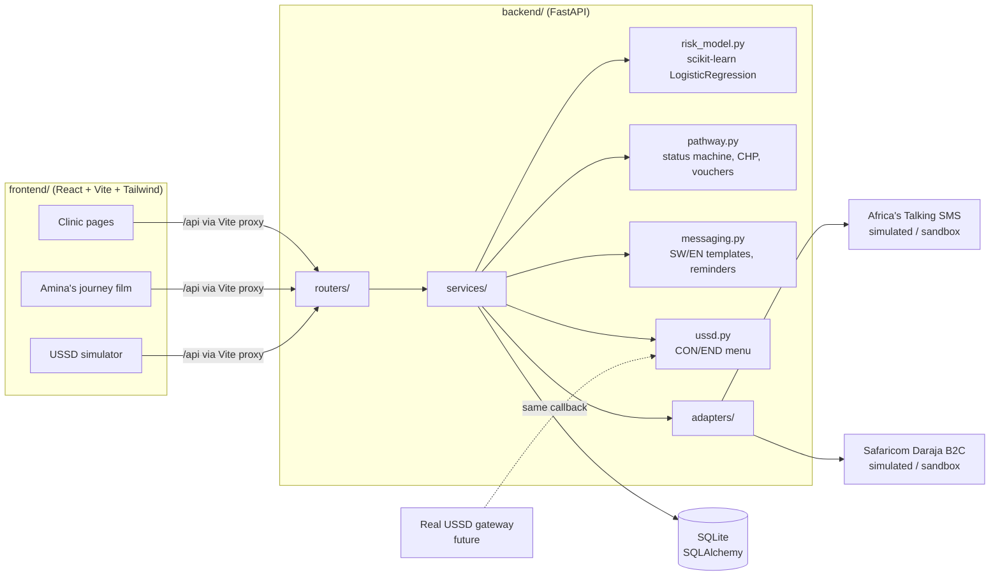

# Fuatilia

**Care, connected.** *Fuatilia* is Kiswahili for "follow up".

> Africa doesn't only lose cancer patients because we fail to find them. We lose them after we find them.

Fuatilia is an AI cancer care navigator, built as a hackathon MVP. It helps women who screen positive for cervical cancer reach treatment, starting in Kenya.

- **Predict who will drop out.** A logistic regression model scores each woman's risk of being lost at the screening visit and explains the score in plain language.
- **Remove the reasons people drop out.** It sends SMS reminders in Kiswahili and English, offers a USSD menu that works on any feature phone, and gives every high-risk woman a community health promoter (CHP). When she checks in at the treatment site, an **M-Pesa transport voucher** is released.
- **Speed up diagnosis.** Smartphone-microscope slide photos go into a triage queue sorted by urgency. A pathologist confirms every case.

The main measure is **the share of screen-positive women who complete treatment.**

> **Privacy and safety:** this project uses **synthetic data only** and holds no real patient information. A real deployment must comply with **Kenya's Data Protection Act, 2019**, run a data protection impact assessment, and obtain **informed consent before any SMS or USSD contact**. SMS texts never mention cancer, because phones are often shared. The risk model and the pathology scores have not been clinically validated. They support clinicians and pathologists and never replace them.

---

## Run it locally

You need Python 3.10+ and Node.js 18+.

```bash
make install   # once: creates backend/.venv and installs npm packages
make dev       # starts the API on :8000 and the web app on :5173
```

Open **http://localhost:5173** to see the public website (hero, problem, solution, film, about). Press **Demo mode** in the top bar to run the film against the live system, or go to **Clinic dashboard** for the platform itself. The interactive API docs are at http://localhost:8000/docs.

On first start, the API creates `backend/fuatilia.db`, seeds it with **500 synthetic women** (Amina is one of them) and trains the risk model. To start fresh, run `make reset`.

<details>
<summary>Without make (two terminals)</summary>

```bash
# Terminal 1: API
cd backend
python3 -m venv .venv && source .venv/bin/activate
pip install -r requirements.txt
uvicorn app.main:app --reload --port 8000

# Terminal 2: web app
cd frontend
npm install
npm run dev
```
</details>

To try it on a phone, connect to the same Wi-Fi and open `http://<your-laptop-ip>:5173`. `make dev` already serves the web app on your network.

---

## The demo: Amina's journey

**Demo mode** plays a narrated photo film of about two minutes, also embedded on the home page. It follows Amina, 34, from Lodung'okwe in Samburu County. Her nearest treatment hospital is 68 km away in Maralal.

- **Real photographs**, with slow camera moves and crossfades. No cartoons.
- **Narration** uses the browser's speech engine. In **Microsoft Edge** it picks Kenyan neural voices: *Asilia* (English, Kenya) or *Zuri* (Kiswahili, Kenya). Other browsers fall back to the closest English voice. Subtitles follow the narrator sentence by sentence.
- **Background music** is a soft corporate-style loop generated live in the browser, so it is licence-free. It dips under the narration. To use a real track instead, place a royalty-free MP3 you have rights to at `frontend/public/media/music.mp3`; it is detected automatically.
- **Live system:** the phone screens (SMS, USSD and M-Pesa) come from the real API. If the API is offline, built-in demo data keeps the film playing.

| # | Scene | What happens in the system |
|---|-------|----------------------------|
| 1 | Amina at home in Lodung'okwe | — |
| 2 | Dispensary: VIA positive | `POST /api/demo/amina/reset` registers her. The model returns **high risk** with its 3 reasons, and CHP Grace is auto-assigned |
| 3 | Kiswahili SMS | The intro SMS is sent through the Africa's Talking adapter (simulated) |
| 4 | She dials `*384*12#` | Two calls to `POST /api/ussd` (menu, then `1`) confirm her appointment. Her status changes to *Navigating* |
| 5 | Grace's home visit | `POST /api/chp/visits/{id}` |
| 6 | Matatu to Maralal | — |
| 7 | Check-in | `POST /api/patients/{id}/check-in` releases the **M-Pesa voucher** (Daraja B2C adapter, simulated) |
| 8 | Treated | `POST /api/patients/{id}/treat` sets a rescreen date 12 months out |
| 9 | Closing line | — |

Controls: play/pause, scene skip, and toggles for music, narration and subtitles, plus fullscreen. Keyboard: **Space**, **← →** and **F**. **To make an MP4** for a pitch deck, open the film in Edge, go fullscreen and record the screen with system audio (on macOS, ⌘⇧5 records video only; use QuickTime with an audio loopback device such as BlackHole, or OBS). Switch the site to **SW** for Kiswahili narration and subtitles.

After the film, open Amina's profile to show her full timeline, messages and voucher. Then show the USSD simulator, the CHP worklist and the Impact page.

---

## Features

| Page | What it does |
|------|--------------|
| **Home** (`/`) | Public website: a hero carousel (two photos, changing every 12 s), key numbers, the problem, the solution in three layers, how it works, the film, live platform figures, about, who it serves and a call to action. |
| **Clinic dashboard** (`/dashboard`) | Treatment completion rate as the headline number, plus days to treatment, number lost to follow-up and vouchers paid. A pathway bar shows how many women are at each status, and the patient table has search and filters by risk, status and county. It switches to cards on mobile. |
| **Register screening** | A form for a new positive screen. The **risk score updates as you type** and shows its top 3 reasons. Village and facility fields offer suggestions for each county. The SMS consent box is required. |
| **Patient profile** | Pathway stepper, timeline, risk explanation, SMS log (sent and scheduled, with character and segment counts), voucher status, and buttons for **Mark checked in** (voucher amount can be changed), **Mark treated**, *Send reminder* and *Mark lost*. |
| **CHP worklist** | Active high-risk women, with those not yet visited first. Each card has a tap-to-call link, a visit note and a **Mark visited** button. |
| **USSD simulator** | A feature-phone mockup that sends requests to the **same Africa's Talking-style callback** a real gateway would use. You can confirm, reschedule, find a clinic by county, request a CHP call back, and switch between English and Kiswahili. |
| **Pathology queue** | Upload or take a slide photo to get a **mock** urgency score. The queue is sorted by urgency, and the pathologist confirms or rejects each case. Every case is labelled **"AI suggestion — pathologist must confirm."** |
| **Impact** | A simulated comparison of completion with and without Fuatilia, broken down by risk band and by county. The assumptions are stated on the page, and a table view is available. |
| **Amina's journey** | The demo film described above. |

The UI has an **English and Kiswahili toggle** (EN/SW in the top bar) throughout. Navigation is a floating top bar; the platform tools sit under **Platform**, and on phones everything collapses into a menu.

**Design:** Inter (sans-serif) throughout. Content cards are square boxes. Curved edges are kept for the navbar, hero, film, photos and buttons.

## Photo credits

The photos in `frontend/public/media/` come from [Pexels](https://www.pexels.com/license/), which allows free use without attribution, or were supplied by the team:

| File | Source |
|------|--------|
| `hero-mother.jpg` | Pexels 8248293 |
| `hero-mother-baby.jpg` | Pexels 33555006 |
| `feature-phone.jpg` | Pexels 14127221 |
| `rural-clinic.jpg` | Pexels 4483669 |
| `matatu.jpg` | Pexels 30661414 (Nairobi) |
| `doctor-consult.jpg` | Pexels 6303645 |
| `samburu-community.jpg` | Pexels 16863352 (Wamba, Samburu) |
| `amina.jpg`, `africa-collage.png` | supplied by the team; confirm usage rights before publishing |

To swap a scene photo, for example one from a real Kenyan facility you have permission to use, replace the file and keep its name, or edit `src/components/film/scenes.js`.

---

## Architecture



The same design as plain text:

```
 Browser (React)                 FastAPI                          Storage / providers
 ───────────────                 ───────                          ───────────────────
 Dashboard, Register ─┐          routers/patients ─┐
 Profile, Worklist    ├─ /api ─► routers/chp       ├─► services/ ─► SQLite (synthetic)
 USSD simulator ──────┤          routers/ussd      │   pathway      ─► adapters/sms   ─► Africa's Talking (sandbox only)
 Pathology, Impact    │          routers/pathology │   risk_model   ─► adapters/mpesa ─► Daraja B2C (sandbox only)
 Amina's journey ─────┘          routers/insights ─┘   messaging, ussd, metrics
```

### Project structure

```
canc/
├── Makefile                    # make install / make dev / make reset
├── backend/
│   ├── requirements.txt
│   └── app/
│       ├── main.py             # app setup, startup seeding and training
│       ├── config.py           # all settings (env-overridable)
│       ├── database.py         # SQLAlchemy engine/session
│       ├── models.py           # Patient, Event, Message, Voucher, CHP, PathologyCase
│       ├── schemas.py          # Pydantic request/response models
│       ├── adapters/
│       │   ├── sms.py          # SmsGateway: Simulated | AfricasTalkingSandbox
│       │   └── mpesa.py        # PayoutGateway: Simulated | DarajaB2CSandbox
│       ├── services/
│       │   ├── synthetic.py    # data generator + first-run seed + Amina
│       │   ├── risk_model.py   # logistic regression + plain-language reasons
│       │   ├── pathway.py      # status transitions, CHP assignment, vouchers
│       │   ├── messaging.py    # SMS templates (SW/EN) and reminder schedule
│       │   ├── ussd.py         # USSD menu (Africa's Talking callback format)
│       │   ├── pathology.py    # mock urgency scoring
│       │   ├── metrics.py      # programme metrics + impact simulation
│       │   ├── geography.py    # counties, facilities, CHPs
│       │   └── settings.py     # runtime settings (voucher amount)
│       └── routers/            # patients, chp, ussd, pathology, insights, demo
└── frontend/
    ├── vite.config.js          # proxies /api and /uploads to :8000
    ├── tailwind.config.js      # brand colours and fonts
    └── src/
        ├── App.jsx             # routes
        ├── lib/                # api client, i18n (EN/SW), formatting, hooks
        ├── components/         # Layout (top navbar + footer), UI kit, RiskPanel, Timeline, FeaturePhone
        │   └── film/           # Film player + scene script (photos, narration, overlays)
        ├── lib/music.js        # Web Audio music bed (or public/media/music.mp3)
        ├── lib/narrator.js     # speech synthesis, Kenyan voices preferred
        └── pages/              # Home, Dashboard, Register, PatientProfile, Worklist,
                                # UssdSimulator, Pathology, Impact, Journey
    └── public/media/           # photographs used by the site and film
```

---

## How the pieces work

**Synthetic data** (`services/synthetic.py`). The generator creates 500 women across 10 counties, weighted towards Samburu and Baringo. Each record has an age, county, village, distance to the treatment site, phone type, past missed visits, HIV status and screening method (VIA or HPV). The outcome label comes from a hidden logistic process in which dropout rises with **distance, feature-phone-only access and past missed visits**. It is calibrated to about 32% lost to follow-up, close to the 31.5% reported in a western Kenya programme. Timelines, SMS logs and vouchers are back-filled so they match each woman's outcome.

**Risk model** (`services/risk_model.py`). A scikit-learn `LogisticRegression` on standardised features, trained on startup. Each factor's contribution is `coef × standardised value`, which is exact for a linear model. The top 3 contributions become sentences such as *"Lives 68 km from the treatment site"*, in English and Kiswahili. Bands: low < 30, medium 30–54, high ≥ 55. See `GET /api/model` for the coefficients.

**Support by risk band:**

| Band | SMS reminders | CHP | Earliest appointment |
|------|---------------|-----|----------------------|
| High | 7, 3 and 1 days before | auto-assigned (prefers the CHP covering her village) | 10 days |
| Medium | 3 and 1 days before | — | 14 days |
| Low | 1 day before | — | 21 days |

Every woman receives an M-Pesa transport voucher when she is checked in (default KES 1,500). You can change the amount with `FUATILIA_VOUCHER_KES`, with `PUT /api/settings`, or for one patient on her profile page.

**Pathway:** `Screened Positive → Navigating → Checked In → Treated → Rescreen Due`, and `Lost to Follow-up` from any active status. Invalid transitions return HTTP 409.

**Integrations: sandbox only.** Both adapters run in simulated mode by default, so nothing leaves the machine.

```bash
# Africa's Talking SMS sandbox
FUATILIA_SMS_MODE=sandbox AT_API_KEY=... make api
# Safaricom Daraja B2C sandbox
FUATILIA_MPESA_MODE=sandbox DARAJA_CONSUMER_KEY=... DARAJA_CONSUMER_SECRET=... \
  DARAJA_SECURITY_CREDENTIAL=... DARAJA_RESULT_URL=https://... make api
```

The provider hosts are hard-coded to the sandbox URLs (`api.sandbox.africastalking.com` and `sandbox.safaricom.co.ke`). The sandbox code paths have not been tested against live sandbox credentials. `POST /api/ussd` already follows the Africa's Talking USSD callback format (`sessionId, serviceCode, phoneNumber, text`, replying `CON …` or `END …`), so connecting a real sandbox USSD channel only needs a public URL.

**Pathology triage is a mock.** The urgency score comes from a hash of the image bytes: the same image always gets the same score, and no tissue is analysed. It exists to show the workflow, in which the pathologist sees the most urgent cases first and confirms each one.

**Impact simulation** (`services/metrics.py`). "Without Fuatilia" is the synthetic ground truth. "With Fuatilia" assumes these relative reductions in dropout: SMS/USSD reminders −15%, CHP visit for high-risk women −30%, voucher for women more than 30 km away −25%. The reductions multiply together. These figures are illustrative and do not come from trials.

## API overview

| Method | Path | Purpose |
|--------|------|---------|
| GET | `/api/metrics` | completion rate, average days to treatment, number lost, vouchers |
| GET | `/api/patients` | list with filters `risk`, `status`, `county`, `q`, `sort`, `limit`, `offset` |
| POST | `/api/patients` | register a positive screen → risk score, CHP, SMS |
| POST | `/api/risk/score` | risk preview without saving |
| GET | `/api/patients/{id}` | profile with timeline, messages and vouchers |
| POST | `/api/patients/{id}/check-in` · `/treat` · `/lost` · `/remind` | pathway actions |
| GET | `/api/chp/worklist` · POST `/api/chp/visits/{id}` | CHP worklist and visits |
| POST | `/api/ussd` | USSD callback (form-encoded, text/plain reply) |
| GET/POST | `/api/pathology` · POST `/api/pathology/{id}/review` | triage queue |
| GET | `/api/impact` · `/api/model` · `/api/meta` · `/api/facilities?q=` | insights and reference data |
| POST | `/api/demo/amina/reset` | replay the demo |

## Why this matters

- In one western Kenya cervical screening programme, **31.5%** of women were lost to follow-up overall, rising to **49.3%** between biopsy and LEEP. In Ethiopia, only 34.8% of treated women came back for rescreening. The main reasons were lack of time, forgotten appointments and visits to other facilities. These are coordination problems, not medical ones.
- Kenya's **CATSystem** tracking tool already showed that enrolled women received better follow-up. Fuatilia builds on that approach and adds risk prediction, mobile-money incentives and pathology triage.
- Sub-Saharan Africa has about **one pathologist per million people**. Triage helps each pathologist reach more patients sooner.

Sources: Frontiers in Medicine (2022), doi:10.3389/fmed.2022.930462; PMC6722111.
