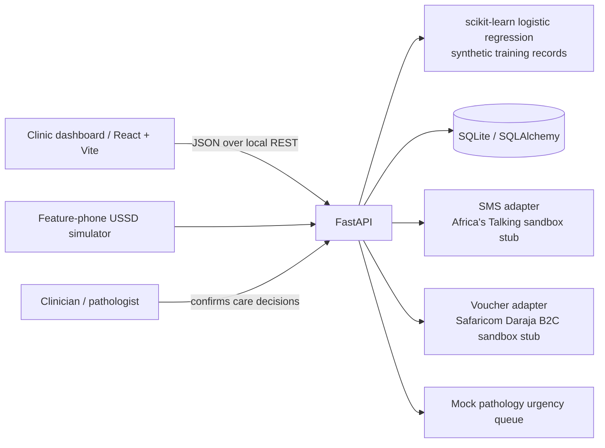

# Fuatilia

**Care, connected.** Fuatilia is a Kenya-first hackathon MVP for helping women with a positive cervical cancer screen complete treatment. It combines risk-led navigation, SMS/USSD reminders, community health promoter worklists, simulated transport vouchers and a human-confirmed pathology triage queue.

> **Privacy & safety:** This demo uses synthetic data only. It contains no real patient information and does not provide medical advice or diagnosis. A real deployment must comply with Kenya's Data Protection Act, 2019, conduct a privacy impact assessment, protect sensitive health data, and obtain informed consent before SMS/USSD contact. AI risk estimates and mock slide urgency are decision-support demonstrations only; clinicians and pathologists retain responsibility for care decisions.

## Project structure

```text
canc/
├── backend/
│   ├── app/
│   │   └── main.py           # FastAPI, SQLAlchemy models, synthetic seed, ML + APIs
│   ├── requirements.txt
│   └── fuatilia.db            # Created automatically on first API startup
├── frontend/
│   ├── src/
│   │   ├── App.jsx            # Responsive application and feature pages
│   │   ├── main.jsx
│   │   └── styles.css
│   ├── index.html
│   └── package.json
└── README.md
```

## Run locally

Requires Python 3.10+ and Node.js 18+.

Install backend dependencies once:

```bash
cd backend && python -m venv .venv && source .venv/bin/activate && pip install -r requirements.txt
```

Install frontend dependencies once:

```bash
cd frontend && npm install
```

Then start the API and frontend in two terminals (two run commands):

```bash
cd backend && source .venv/bin/activate && uvicorn app.main:app --reload
```

```bash
cd frontend && npm run dev
```

Open <http://localhost:5173>. API docs are at <http://localhost:8000/docs>. The SQLite database is seeded with 500 synthetic women on first startup; the first record is Amina, the end-to-end demo patient. To reset her journey, use **Demo Amina's journey** in the app. Seeded clinic-wide records remain synthetic.

## Demo walkthrough

- **Clinic dashboard:** completion rate, follow-up metrics, risk and pathway filters, and patient list.
- **Amina's journey:** the demo button resets and walks through screening positive → high risk → Swahili SMS → simulated USSD confirmation → clinic check-in → simulated M-Pesa voucher → treated/rescreen due.
- **Register screening:** create a synthetic positive result; the logistic regression risk score and plain-language contributing factors appear on the profile.
- **Patient profile:** pathway timeline, risk explanation, SMS log, facility, CHP and voucher status; simulate check-in and treatment.
- **CHP worklist:** high-risk synthetic cases, assigned community health promoter and visit action.
- **USSD simulator:** feature-phone mockup for appointment confirmation or rescheduling in English or Kiswahili. The modeled short code is `*384#`.
- **Pathology queue:** upload an image to create a mock urgency score sorted for human review. The interface labels it **AI suggestion — pathologist must confirm**.
- **Impact page:** illustrative synthetic before/after comparison. It is not clinical evidence.

## Architecture



## Safety and integration boundaries

- `AfricaTalkingAdapter` and `DarajaB2CAdapter` are sandbox-only stubs that generate simulated references. No outbound SMS or money movement is performed.
- The risk model is a logistic regression trained at startup on 500 generated examples. It supports care coordination only; it is not clinically validated and must not be used to deny or delay care.
- The pathology endpoint accepts image uploads for mock triage only. Images are not analyzed for disease; urgency is deterministic mock output. A pathologist must confirm findings.
- In a real deployment, replace the stubs only after security review, informed consent, regulatory assessment, clinical validation, and appropriate agreements with the service providers.
